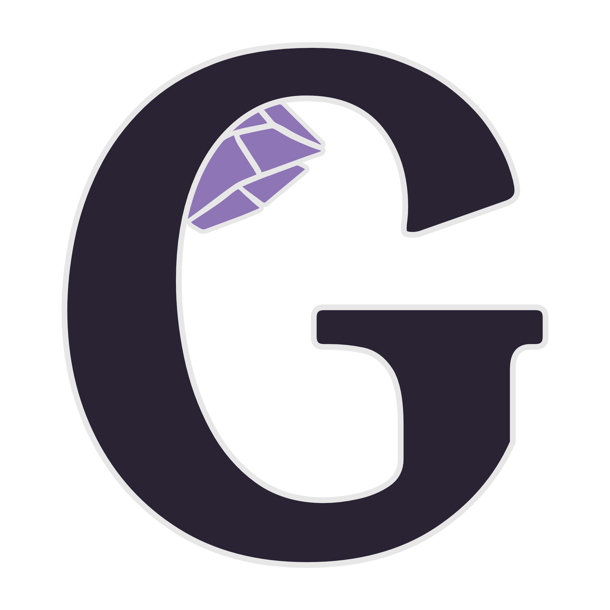

<p align="center">
  
</p>

<h1 align="center">Geode</h1>

<p align="center">
  <strong>A powerful wrapper for Minecraft Bedrock Dedicated Server</strong>
</p>

<p align="center">
  <a href="#features">Features</a> •
  <a href="#quick-start">Quick Start</a> •
  <a href="#configuration">Configuration</a> •
  <a href="#api-reference">API Reference</a> •
  <a href="#contributing">Contributing</a>
</p>

<p align="center">
  
  
  
  
</p>

---

## Why Geode?

Most custom Minecraft Bedrock servers implement their own protocol from scratch. While powerful, this approach means:

- Long development cycles to reverse-engineer each update
- Missing features that exist in vanilla Bedrock
- Constant maintenance as Minecraft evolves

**Geode takes a different approach.** It wraps the official Bedrock Dedicated Server, giving you vanilla gameplay with enterprise-grade management features. When Mojang releases an update, Geode is ready.

## Features

### Server Management

| Feature | Description |
|---------|-------------|
| **Auto-Updates** | Automatically downloads and installs the latest Bedrock Server on startup |
| **Graceful Restarts** | Scheduled restarts with player notifications and safe shutdown |
| **Live Logs** | Real-time log streaming via Server-Sent Events |
| **Command Execution** | Send any Minecraft command through the REST API |

### Backup System

| Feature | Description |
|---------|-------------|
| **Hourly Backups** | Automatic world saves every hour |
| **Daily/Monthly Archives** | Long-term backup retention with configurable schedules |
| **Cloud Storage** | Upload backups to Google Cloud Storage or AWS S3 |
| **One-Click Restore** | Restore any backup via API with automatic server management |
| **Rollback on Crash** | Optionally auto-restore to last backup after a crash |

### Live Map Rendering

Geode integrates with [Unmined CLI](https://unmined.net/) to generate web-based world maps:

- **Multi-dimensional** - Overworld, Nether, and End renders
- **Automatic Updates** - Maps refresh on a configurable schedule
- **Custom Styling** - Configurable map settings per dimension

### Discord Integration

Connect your server to Discord with real-time relays:

- Player join/leave notifications
- Chat messages bridged both directions
- Server start/stop/crash alerts
- Backup completion notices

### REST API & Dashboard

A fully-documented REST API with OpenAPI/Swagger UI at `/api/docs`:

```
POST /api/controls/start     - Start the server
POST /api/controls/stop      - Stop the server
POST /api/controls/restart   - Restart the server
POST /api/controls/command   - Execute a Minecraft command
GET  /api/controls/logs      - Stream live logs (SSE)

GET  /api/backups            - List all backups
POST /api/backups            - Trigger a manual backup
POST /api/backups/restore    - Restore from a backup

GET  /api/info               - Server status and info
```

---

## Quick Start

### Prerequisites

- Docker and Docker Compose
- (Optional) Google Cloud or AWS account for cloud backups

### Run with Docker

```bash
# Clone the repository
git clone https://github.com/your-org/geode.git
cd geode

# Create config from template
cp config.default.yml config.yml

# Start the server
docker-compose up -d
```

Geode will automatically:
1. Download the latest Bedrock Dedicated Server
2. Install Unmined CLI for map rendering
3. Start the Minecraft server on port `19132`
4. Launch the REST API on port `8000`

### Accessing Your Server

| Service | Port | URL |
|---------|------|-----|
| Minecraft | 19132/UDP | `your-server:19132` |
| REST API | 8000 | `http://your-server:8000` |
| API Docs | 8000 | `http://your-server:8000/api/docs` |

---

## Configuration

Geode is configured via `config.yml`. Here's a complete reference:

### Backups

```yaml
backup:
  enabled: true
  location: "local"           # Options: local, gcloud, s3
  bucket_name: "my-backups"   # Required for gcloud/s3
  
  hourly_backups:
    cloud_subdirectory: "hourly"
  
  daily_backups:
    enabled: true
    hour: 11                  # UTC hour (0-23)
    cloud_subdirectory: "daily"
  
  monthly_backups:
    enabled: true
    day: 25                   # Day of month
    cloud_subdirectory: "monthly"
  
  include_addons: true        # Backup resource/behavior packs
  include_server_files: true  # Backup server.properties, allowlist, etc.
```

### Cloud Storage Setup

<details>
<summary><b>Google Cloud Storage</b></summary>

```bash
# Set your service account credentials
export GOOGLE_APPLICATION_CREDENTIALS="/path/to/keyfile.json"

# Run with gcloud requirements
docker build --build-arg CLOUD_SERVICE=gcloud -t geode:gcloud .
```

</details>

<details>
<summary><b>AWS S3</b></summary>

```yaml
backup:
  location: "s3"
  bucket_name: "my-minecraft-backups"
  aws_credentials:
    access_key: "YOUR_ACCESS_KEY"
    secret_key: "YOUR_SECRET_KEY"
```

</details>

### Discord Relay

```yaml
discord_relay:
  nexuscore_api_key: "your-api-key"
  discord_guild_id: "123456789"
  relay_events:
    server_start_stop: true
    server_crashes: true
    player_joins_leaves: true
    player_deaths: true
    chat: true
    backups: true
```

### Server Maintenance

```yaml
restarts:
  enabled: true
  interval_hours: 72          # Restart every 3 days

updates:
  auto_update_on_start: true
  auto_update_if_empty: true  # Update when server is empty for 20min

maintenance:
  allowed_players:            # Non-OPs allowed during maintenance
    - "AdminGamertag"

rollbacks:
  auto_rollback_on_crash: true
```

### World Border (Amethyst Addon)

```yaml
amethyst_addon:
  enable: true
  world_border:
    enabled: true
    overworld_radius: 2000
    nether_radius: 2500
    end_radius: 500
  elytra_remove_mending: true  # Balance: remove mending from elytras
```

---

## API Reference

### Authentication

Currently, the API is designed for trusted network access. For production deployments, place behind a reverse proxy with authentication.

⚠️ DO NOT expose port `8000` to the internet!

### Endpoints

#### Server Controls

```http
POST /api/controls/start
POST /api/controls/stop
POST /api/controls/kill       # Force kill (use with caution)
POST /api/controls/restart
POST /api/controls/command
Content-Type: application/json
{"command": "say Hello World!"}

GET /api/controls/logs        # Server-Sent Events stream
```

#### Backups

```http
GET /api/backups              # List all available backups
POST /api/backups             # Trigger immediate backup
POST /api/backups/restore
Content-Type: application/json
{"full_path": "hourly/world_2024-01-15_10-00-00.zip"}
```

#### Server Info

```http
GET /api/info                 # Server status, version, online players
GET /api/messages             # Scheduled broadcast messages
POST /api/messages            # Schedule a new broadcast
```

---

## Contributing

We welcome contributions! Please see our guidelines:

1. Fork the repository
2. Create a feature branch (`git checkout -b feature/amazing-feature`)
3. Commit your changes (`git commit -m 'Add amazing feature'`)
4. Push to the branch (`git push origin feature/amazing-feature`)
5. Open a Pull Request

### Development Setup

```bash
# Create virtual environment
python -m venv .venv
source .venv/bin/activate

# Install dependencies
pip install -r requirements/local.txt

# Run in development mode
python webserver.py
```

---

## License

This project is licensed under the MIT License - see the [LICENSE](LICENSE) file for details.

---

## Acknowledgments

- [Minecraft Bedrock Dedicated Server](https://www.minecraft.net/en-us/download/server/bedrock) by Mojang
- [Unmined CLI](https://unmined.net/) for world map rendering
- [Sanic](https://sanic.readthedocs.io/) for the async web framework

<p align="center">
  <sub>Built with care for the Minecraft community</sub>
</p>
